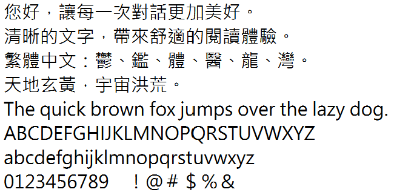
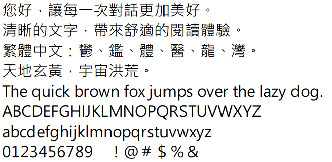
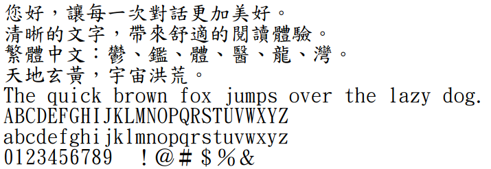
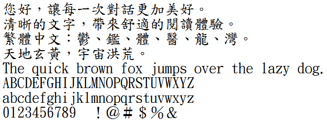
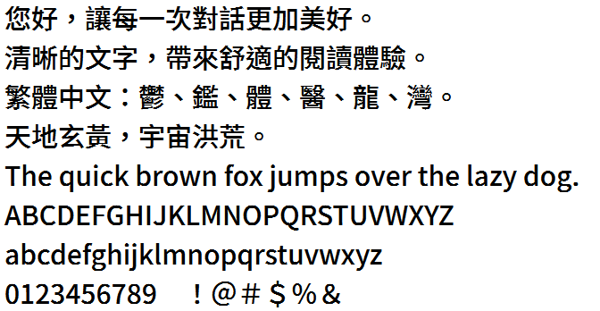
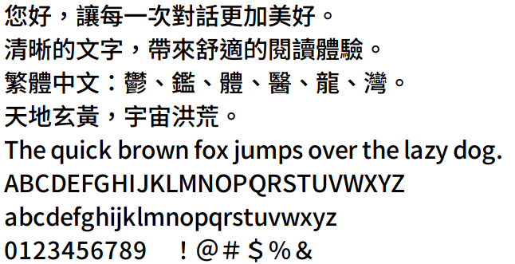

# LINE Font Enhancer

**熟悉的 LINE，不一樣的質感。**

免費、輕量、離線的 Windows LINE 電腦版字體渲染優化工具（非官方）。透過 Qt 的 FreeType 字體引擎改善文字顯示，不修改 LINE 執行檔或 DLL。

## 下載

[前往 Releases 下載測試版](https://github.com/xcom2001tw-collab/LINE-Font-Enhancer/releases)

## 真實比較

Windows 11、200% 顯示縮放實測。左側原廠、右側 FreeType；僅裁切測試文字，沒有人工銳化。不同螢幕、字型及 LINE 版本效果可能不同。

| 字型 | 原廠 | FreeType |
|---|---|---|
| 微軟正黑體 |  |  |
| 金萱粉圓體 |  |  |
| 標楷體 |  |  |
| 新細明體 |  |  |
| Noto Sans TC Medium |  |  |

## 使用方式

1. 從 Releases 下載 EXE，執行後確認 LINE 安裝位置。
2. 按「實際試用」比較效果，或按「一鍵美化 LINE」套用。
3. 套用前請完成通話、傳檔及未送出訊息；工具會詢問關閉 LINE，必要時另行確認強制結束。
4. 使用新建的 LINE FreeType 捷徑；如需恢復，按「還原設定」。

## 相容性與安全性

- Windows 10/11 x64 為目標平台，需使用支援 FreeType 參數的 LINE Qt 版本。已在開發者 Windows 11 環境試用，尚未完成廣泛相容性驗證。
- 僅在 LINE 子程序設定 `QT_QPA_PLATFORM=windows:fontengine=freetype`，不變更全域字體設定。
- 套用會複製啟動器至 `%LOCALAPPDATA%\LINE-FreeType-Tool`，建立捷徑；可選擇備份並停用目前使用者可辨識的 Run / Startup 自啟項目。
- 啟動時會嘗試清除本工具舊版專用 Qt 快取，保留設定及備份。工具無網路下載或遙測功能；LINE 自身網路行為不受此說明涵蓋。
- EXE 尚無數位簽章，可能出現 SmartScreen 警告。請不要關閉防毒軟體；可核對 SHA-256、檢視原始碼或自行編譯。
- 非 LINE 官方產品，與 LINE 官方無隸屬關係。展示圖片不包含字型檔案。

## 編譯

Go 1.20+；在 Windows PowerShell 中，於原始碼所在資料夾執行：

```powershell
$env:GOOS="windows"
$env:GOARCH="amd64"
$env:CGO_ENABLED="0"
$env:GO111MODULE="off"
go build -trimpath -ldflags "-H windowsgui -s -w" -o LINE_Font_Enhancer.exe .
```

目前版本：V2.0 RC5（公開測試候選版）。問題請至 [Issues](https://github.com/xcom2001tw-collab/LINE-Font-Enhancer/issues) 回報，勿附私人聊天資料。

原始碼供檢視；正式授權條款待專案擁有者確認。
